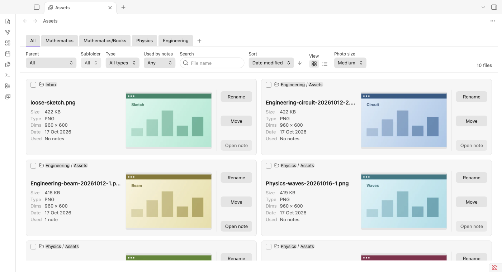
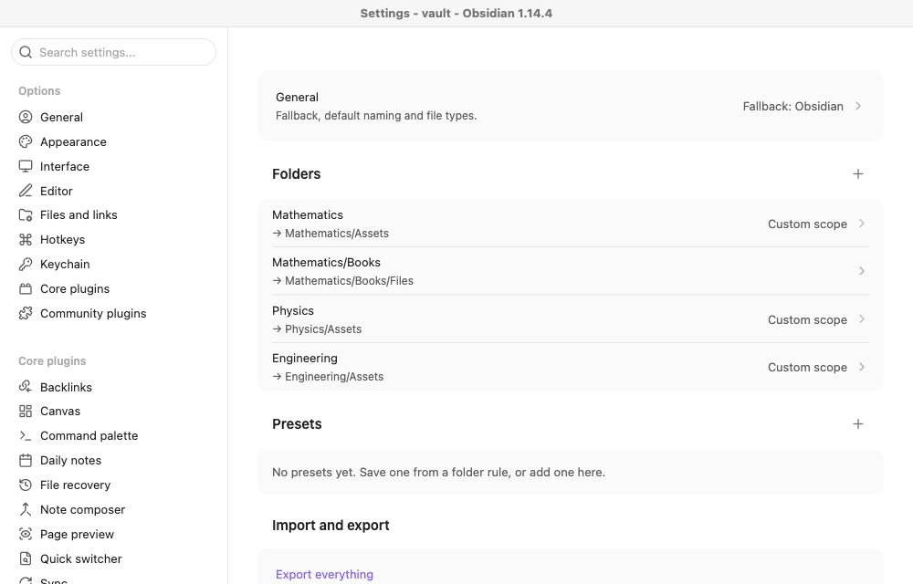

# Foldwise

Paste a screenshot into a note and Foldwise saves it in the right folder. Then it gives you one page to find, rename and move every image and PDF you have saved.

## What it does

**Saves pasted files where you want them.** Give a folder a rule, such as "notes in `Physics` save to `Physics/Assets`". Subfolders follow the nearest rule, and you can exclude some of them. Files are named like `Physics-ramp-20261013-1.png`, and nothing is ever overwritten.

**One page for everything you have saved.**

- Browse as a grid or a list, with a tab for each folder rule.
- Filter by folder, type, name, and whether any note uses the file.
- Rename or move a file and every link to it keeps working.
- Rename or move many files at once.
- Open the note that uses a file.
- Handles 10,000+ files smoothly. Small cached previews live in the plugin's own folder, never in your vault, and your original files are never copied.

## Set up

Open **Settings → Foldwise**, then add a folder under **Folders**. Pick the folder it applies to and where its files should go. The page has a live summary and a test box where you can try a note path.

Open the page from the ribbon icon, the command palette ("Open asset manager"), or by right-clicking a folder and choosing **Open assets for this folder**.

You can also keep naming and scope settings as **presets**, and export or import everything as plain JSON.

## Install by hand

1. Run `npm install` and then `npm run build`.
2. Copy `main.js`, `manifest.json` and `styles.css` into `<your vault>/.obsidian/plugins/foldwise/`.
3. Turn the plugin on under **Settings → Community plugins**.

Needs Obsidian 1.13.4 or newer. It works on desktop; mobile has not been tested on a real device.

## Development

`npm run dev` rebuilds on change, `npm test` runs the tests, and `npm run lint` checks the code. The design is in [docs/SPEC.md](docs/SPEC.md).

## Licence

[MIT](LICENSE) © 2026 Anthirayas. Free to use, change and share, as long as the licence notice stays with it.
